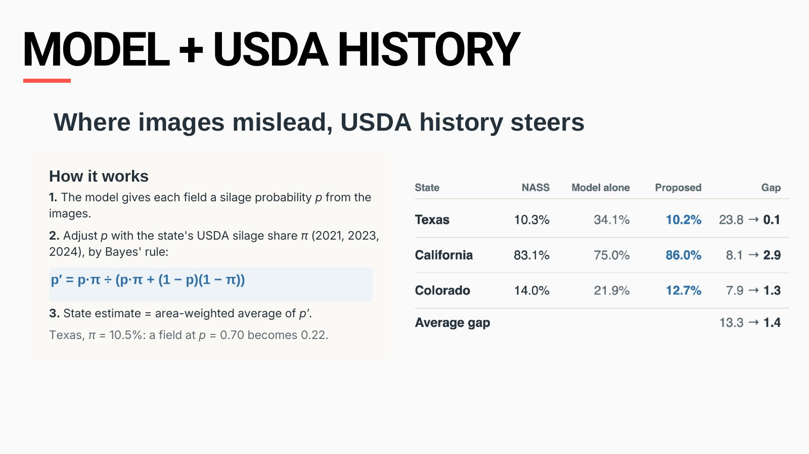
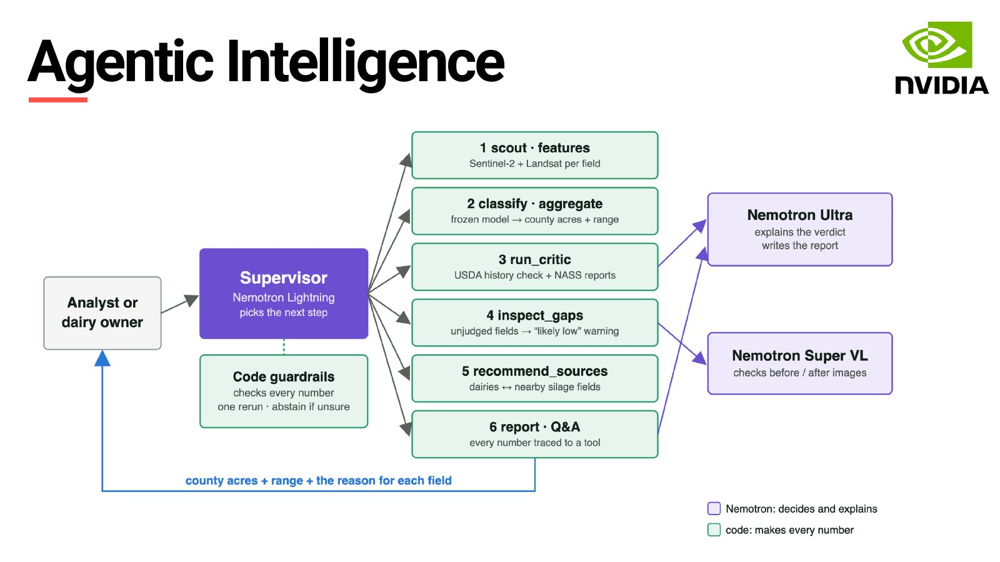
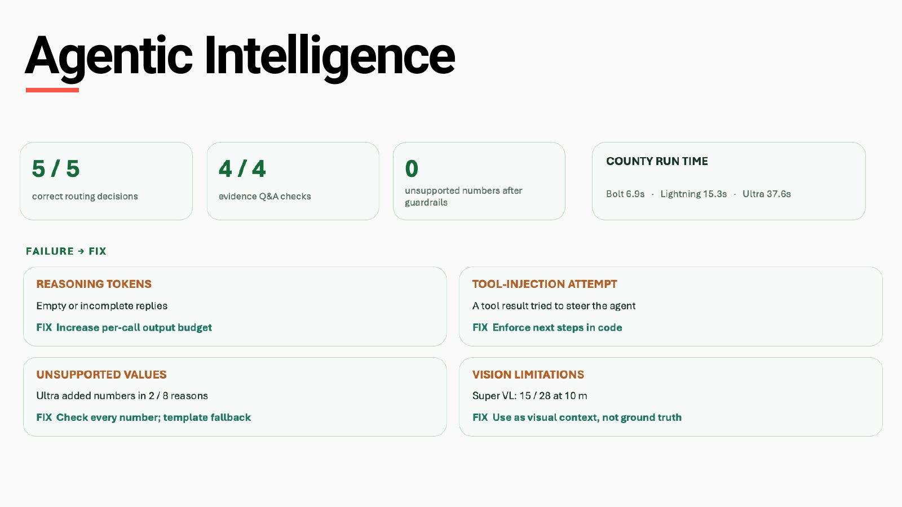

# FieldVision

**An explainable, satellite-driven corn harvest intelligence system.** Was this corn field chopped green for
**silage** or left to dry for **grain**? FieldVision answers that for every corn field from free public satellite
data, explains each call, adds the fields up to county and state acres, and checks them against USDA NASS.
Built for Hack the Harvest 2026 (USDA NASS challenge) by **Team makai**: Hetvi Bhadani, Hima Verma, Krishi Shah,
Priyanka R, Siyun Chen. **Grand Prize, 1st place.**

**Presentation:** [`handoff/presentation/FieldVision.pdf`](handoff/presentation/FieldVision.pdf) (17 slides).
Every figure the system produces is a **model estimate, not a NASS statistic**.


**Results at a glance**

| Test | Result |
|---|---|
| 44 labelled US fields (Beltsville, MD), trained with zero US labels | **42 of 44 right**; precision and recall 91.7% |
| Clean tests against USDA (rules written first, run once) | **4 of 5 within 5 points**; Pennsylvania 2025 missed |
| Model alone, 7 states | average gap **2.0 points** |
| Model + USDA history (Texas, California, Colorado) | average gap **13.3 → 1.4 points** |
| Landsat 8/9 added for cloud gaps | hidden fields **217 → 136** |
| Sentinel-1 radar replay (France, 3-5 week optical gap) | recall **0.33 → 0.54** |
| Nemotron agents | 5/5 routing, 4/4 Q&A, **0 unsupported numbers** |

- [What it does](#what-it-does)
- [Results](#results)
- [Results slides](#results-slides)
- [Quick start](#quick-start)
- [How it works](#how-it-works)
- [Repository map](#repository-map)
- [Data](#data)
- [Reproduce the main results](#reproduce-the-main-results)
- [Tests](#tests)
- [Known limits](#known-limits)
- [Working together](#working-together)

## What it does

| For | What they get |
|---|---|
| A USDA NASS analyst | County silage and grain acres with a range, the reason behind each field's call, a check against USDA history, a written report and cited answers, a US map from states down to fields, and a dashboard of corn supply, stocks and price |
| A dairy owner | Standing corn near the dairy that could still be bought for silage: tons, road miles and a delivered price range, on a map |

Code computes every number. Nemotron (NVIDIA's hosted models) decides the order of steps, checks the result and
explains it, and code checks every number it writes.

## Results

The figures below come from the logged runs and match the presentation. The full record, with which results were clean tests and
when each was logged, is in [`docs/RESULTS.md`](docs/RESULTS.md) and [`handoff/results/REPORT.md`](handoff/results/REPORT.md).

### Field level: 44 labelled US field-years (Beltsville, MD, 2021-23)

Trained with **zero US labels** (8,000 labelled European fields from three countries), scored once.

| | Predicted silage | Predicted grain |
|---|---|---|
| **Truly silage** | 11 | 1 |
| **Truly grain** | 1 | 31 |

| Accuracy | Precision | Recall | F1 | False positive rate | Speed |
|---|---|---|---|---|---|
| 95.5% (42 of 44) | 91.7% | 91.7% | 91.7% | 3.1% | 14 ms per field |

For comparison: a larger gradient-boosted model gets 37 of 44, and always saying "grain" gets 32 of 44.

### Clean tests against USDA

Each place was run once, under rules written down before it was opened, with Sentinel-2 and Landsat 8/9.
Silage share of harvested corn acres; ranges in brackets.

| Place | FieldVision | USDA | Gap (points) | Logged result |
|---|---|---|---|---|
| Michigan 2025 (state) | 14.4% [10.8, 18.0] | 14.7% (NASS 2025) | −0.3 | pass |
| Lancaster County, PA 2023 | 26.6% | 27.4% (Census 2022) | −0.8 | pass |
| New York 2025 (state) | 48.7% [43.3, 54.2] | 53.2% (NASS 2025) | −4.5 | pass |
| Wisconsin 2025 (state) | 16.6% [13.8, 19.5] | 21.6% (NASS 2025) | −5.0 | pass, by 0.02 point |
| Pennsylvania 2025 (state) | 15.2% [12.9, 17.5] | 32.8% (NASS 2025) | −17.6 | **missed** |

**Four of these five are within 5 points of USDA; Pennsylvania is missed.** Earlier clean tests: Maryland 2025,
4.75% [3.4, 6.3] against 8.9% (4.2 low); Branch County MI 2022, 2.1% against 1.8% (pass); Gratiot County MI
2022, 30.0% against 24.2% (pass under its logged rule).

### Earlier state samples: model alone

300 fields per state, Sentinel-2, from the runs used while building the method (not clean tests). Within 5
points of USDA in 7 states:

| State | NASS 2025 | Model alone | Gap (points) |
|---|---|---|---|
| Iowa | 1.9% | 6.2% | 4.3 |
| Minnesota | 4.1% | 6.4% | 2.3 |
| Kansas | 3.4% | 1.3% | 2.1 |
| Michigan | 14.7% | 12.7% | 2.0 |
| South Dakota | 5.8% | 4.3% | 1.5 |
| Nebraska | 2.1% | 0.7% | 1.4 |
| Wisconsin | 21.6% | 22.2% | 0.6 |
| **Average** | | | **2.0** |

### Model + USDA history: where images mislead, USDA history steers

Each field's silage probability *p* is adjusted with the state's recent USDA silage share π (2021, 2023, 2024) by
Bayes' rule, p′ = p·π ÷ (p·π + (1 − p)(1 − π)), and the state estimate is the area-weighted mean of p′. On the
earlier samples (not clean tests):

| State | NASS 2025 | Model alone | Model + USDA history | Gap |
|---|---|---|---|---|
| Texas | 10.3% | 34.1% | 10.2% | 23.8 → 0.1 |
| California | 83.1% | 75.0% | 86.0% | 8.1 → 2.9 |
| Colorado | 14.0% | 21.9% | 12.7% | 7.9 → 1.3 |
| **Average** | | | | **13.3 → 1.4** |

Counting the fields hidden by cloud by the model's own call brings two counties seen while tuning close to the
Census: Frederick County MD 2022, 19.2% against 19.6%, and Wyoming County NY 2022, 64.9% against 66.7%.

### Cloud gaps: Landsat 8/9 as a second satellite

| | Sentinel-2 only | + Landsat 8/9 |
|---|---|---|
| Fields hidden by clouds at harvest (8 states) | 217 | 136 |
| Model-alone miss, in points | 3.5 | 2.8 |
| Iowa silage share (NASS 1.9%) | 6.2% | 2.5% |

### Cloud gaps: Sentinel-1 radar (pilot)

Radar sees through cloud, so it can date a harvest the optical pictures missed. In a replay on labelled fields
(France), where a 3-5 week optical gap was cut out around the harvest, a radar harvest date recovered about half
the lost recall:

| | Optical, with the gap | Optical + radar date | Optical, no gap |
|---|---|---|---|
| Silage recall (France) | 0.33 | 0.54 | 0.65 |

The cost: 3-6 points of extra false silage, because residue is then read from older optical pictures. Radar is
not in the final runs. The extractor is built and tested (`src/fieldvision/s1/`, `tests/test_s1.py`), and
the Colab notebooks for Kent County MD 2022 and the Maryland 2025 sample are in
[`colab/extraction/s1_24029_2022/`](colab/extraction/s1_24029_2022/README.md) and
`colab/extraction/us_24_2025_s1/`. Over Marathon County WI, no Sentinel-1 scene falls in the cloudy weeks, so
radar cannot close that gap. The replay's table (`radar_replay.csv`) is not in this repository; the figures above
are as logged in [`docs/RESULTS.md`](docs/RESULTS.md).

### Corn price scenario

A ridge regression on USDA stocks-to-use, last year's price and yield (`src/fieldvision_agents/market/`) sizes
what silage acres do to the grain market: 0.8 points more silage nationally is about 131 million fewer bushels
of grain a year and 2 to 2.5% on price. Its 2026-28 path ($3.42, $3.06, $2.77) rests on acres, yield and use
written into the code, and USDA's September 2026 price is $4.81. Use it to size silage's effect, not to call
next year's price. The agents reach it through the `silage_what_if` tool.

### Agents (Nemotron)

| Correct routing decisions | Evidence Q&A checks | Unsupported numbers after guardrails | County run time |
|---|---|---|---|
| 5 / 5 | 4 / 4 | 0 | Bolt 6.9 s · Lightning 15.3 s · Ultra 37.6 s |

Failures found and fixed: empty replies from reasoning tokens (larger per-call output budget); a tool result that
tried to steer the agent (next steps enforced in code); numbers added by the writer in 2 of 8 reasons (every number
checked, with a template fallback); vision correct on 15 of 28 at 10 m (used as context, never as the label).

### Where it still reads low

Pennsylvania 2025 is the clean test that missed: 15.2% against NASS's 32.8%. Dairy country with long cloud gaps
at harvest reads silage low, because the fields the model cannot judge there are mostly silage, and northern silage
cut after the crop yellows can look like grain. Why, and what closes it:
[`handoff/results/hima/COMBINED_GAP_FINDINGS.md`](handoff/results/hima/COMBINED_GAP_FINDINGS.md).

### Where each result lives

| Result | File |
|---|---|
| Field-level test (Beltsville) | [`handoff/results/REPORT.md`](handoff/results/REPORT.md), per-year calls in `results/MD_202*.jsonl` |
| Clean tests and every logged result | [`docs/RESULTS.md`](docs/RESULTS.md) |
| State samples, 2025 | `handoff/results/agents/states_2025_comparison.json`, `handoff/results/nass_2025_state_targets.csv` |
| County checks (Frederick, Lancaster) | `handoff/results/agents/*_county_check.json` |
| Gap checks and harvest pace | `handoff/results/agents/gap_checks.md`, `handoff/results/hima/` |
| Agent benchmark and evaluation | `src/fieldvision_agents/benchmark/`, `src/fieldvision_agents/evaluation/` |
| Price scenario | `handoff/results/agents/price_impact.json` |
| Numbers quoted in the talk | [`docs/pitch/pitch_numbers.py`](docs/pitch/pitch_numbers.py) |

## Results slides

From the final presentation; the images are in [`handoff/figures/results/`](handoff/figures/results/).

| | |
|---|---|
|  |  |
|  |  |
|  |  |
|  |  |

## Quick start

Python 3.10 or newer.

```bash
git clone https://github.com/ChenSiyun1234/FieldVision && cd FieldVision
uv venv && uv pip install -e ".[agents]"        # or: python -m venv .venv && .venv/bin/pip install -e ".[agents]"
cp .env.example .env                            # optional: add NVIDIA_API_KEY to use Nemotron
```

| Command | What it does |
|---|---|
| `fieldvision doctor` | What this machine can run (data, key, optional packages) |
| `fieldvision test` | Every offline test of the agent side (no key, no network) |
| `fieldvision counties` | County-seasons with data on disk |
| `fieldvision run 24033 2022 --report` | One county-season through the agent, with the written report |
| `fieldvision run 24021 2022 --offline` | The same with the rule-based agent, no language model |
| `fieldvision serve` | The app at <http://127.0.0.1:8765> (dairy owner or USDA analyst) |
| `pytest -q tests` | The model package's tests |

Without `NVIDIA_API_KEY` everything still runs: a rule-based agent calls the same tools under the same guardrails.
County data is not in git; see [Data](#data).

In the app: the map is the main view, history and settings are on the left, **Ask the agent** sits in the corner,
every result has **Download PDF**, and **Light/Dark** switches the theme.

## How it works


**Offline lane (trained once).**

1. **Features** (`src/fieldvision/features/`): each field's Sentinel-2 series, plus Landsat 8/9 where Sentinel-2
   is clouded, becomes harvest signals: when greenness dropped, how green and wet the crop was just before, bare soil
   or residue after.
2. **Models** (`src/fieldvision/model/`): timing rule, timing and moisture rule, a 6-feature logistic, LightGBM and a
   composite, chosen by leave-one-country-out on European labels.
3. **Registry** (`registry/`): the chosen models frozen in versioned folders and loaded read-only.

**Online lane (per county-season).**

1. **Supervisor** (`src/fieldvision_agents/react/`): Nemotron in a reason-then-act loop with the rules enforced in
   code (step order, one rerun, the critic before accept or abstain, no county accepted with no field judged) and an
   audit log of every step.
2. **Tools** (`src/fieldvision/toolbox.py` via `src/fieldvision_agents/fieldvision_bridge/`): scout the imagery,
   compute features, classify each field (or abstain), add up to county acres with a range.
3. **Critic** (`rag-pipeline/`): checks the county share against Quick Stats history; Nemotron explains the verdict
   with passages from NASS reports. It may send the run back once.
4. **Gap check** (`src/fieldvision_agents/gap/`): when 20% or more of the corn is unjudged, warns that the estimate
   likely reads low and gives the range up to "all unjudged fields are silage".
5. **Reporter** (`src/fieldvision_agents/reporter/`): the county report and Q&A, every number checked against the
   tool results.
6. **App** (`src/fieldvision_agents/app/`): command line and web app for both roles; the dairy finder runs on the
   recommender (`recommender/`).

### The agentic loop (NVIDIA Nemotron)


An analyst or dairy owner asks about a county. **Nemotron 3.5 Lightning** is the supervisor: in a
reason-then-act loop it picks the next tool, reads the result and decides what comes next. Code makes every
number; Nemotron decides and explains.

| Step | Tool | What it does |
|---|---|---|
| 1 | `scout` · `extract_features` | What imagery exists per field (Sentinel-2 + Landsat 8/9), then the harvest features |
| 2 | `classify` · `aggregate` | The frozen model calls each field or abstains; fields add up to county acres with a range |
| 3 | `run_critic` | Checks the county share against USDA history; retrieves NASS report passages only when the check fails (agentic RAG) |
| 4 | `inspect_gaps` | Finds fields hidden by cloud at harvest, scores them by harvest timing with Bayes' rule, warns "likely low" at 20% unjudged |
| 5 | `recommend_sources` | Silage Match: dairies short on feed matched to nearby standing corn |
| 6 | report · Q&A | The written report and answers, every number traced to a tool result |

| Model | Role |
|---|---|
| Nemotron 3.5 Lightning | Supervisor: picks each step and calls the tools |
| Nemotron 3 Ultra | Explains the critic's verdict, writes and edits the report, writes a reason for each cloud-hidden field |
| Nemotron 3.5 Super VL | Looks at a field's last clear image before a cloud gap and the first one after it |
| Nemotron 3.5 Bolt | Benchmarked for fast Q&A (6.9 s per county run) |

**Guardrails in code:** fixed step order, one rerun, the critic before accept or abstain, abstain instead of
guessing, and every number Nemotron writes checked against tool results. The loop returns county acres, the
range, and the reason for each field. Between seasons the **5-day watch loop** (`src/fieldvision_agents/watch/`)
reruns the agent only when new clear imagery moves the estimate.

## Repository map

```
FieldVision/
├── README.md                    you are here
├── HANDOFF.md                   hand-over notes from the model team
├── pyproject.toml               package, extras ([agents], [rag], [foundation]) and the `fieldvision` command
├── src/
│   ├── fieldvision/             the model: extraction, features, models, toolbox, county and state totals
│   │   ├── s2/  s1/  ls/        Sentinel-2, Sentinel-1 and Landsat per-field extractors
│   │   ├── features/            harvest features and the Landsat merge
│   │   ├── model/               training, metrics, splits, state estimate
│   │   ├── beltsville/          in-site models fitted on the labelled fields (comparison only)
│   │   ├── labels/              European parcel declaration labels
│   │   ├── anomaly/ foundation/ stream/   experiments (anomaly view, Presto, pixel-chip sequence model)
│   │   ├── app/                 data export for the field-map demo in app/
│   │   └── toolbox.py           the tools the agent calls
│   └── fieldvision_agents/      the agents and the analyst app (guide: src/fieldvision_agents/README.md)
├── registry/                    frozen models, one folder per version (guide: registry/README.md)
├── rag-pipeline/                critic: Quick Stats checks, NASS report index (guide: rag-pipeline/README.md)
├── recommender/                 silage sources for dairies (guide: recommender/README.md)
├── app/                         field-map demo and the vendored map libraries the analyst app serves
├── scripts/                     one-off and pipeline scripts, grouped in scripts/README.md
├── colab/                       Colab extraction notebooks and bundles (guide: colab/README.md)
├── notebooks/agents/            notebooks behind each agent module (guide: notebooks/README.md)
├── tests/                       model package tests (guide: tests/README.md)
├── docs/                        method, decisions, experiment log, results (index: docs/README.md)
├── handoff/                     final deck, result slides as images, result files (guide: handoff/README.md)
├── results/                     model-side result notes (results/README.md)
└── data/                        pointers only; county data lives outside git (data/README.md)
```

**Where to start, by question:**

| I want to… | Read |
|---|---|
| See every result and whether it is a clean test | [`docs/RESULTS.md`](docs/RESULTS.md) |
| See the radar (Sentinel-1) result | [Cloud gaps: Sentinel-1 radar](#cloud-gaps-sentinel-1-radar-pilot), [`colab/extraction/s1_24029_2022/`](colab/extraction/s1_24029_2022/README.md) |
| Understand the model and its features | [`docs/module.md`](docs/module.md), [`docs/model.md`](docs/model.md), [`docs/features.md`](docs/features.md) |
| Understand the agents and the app | [`src/fieldvision_agents/README.md`](src/fieldvision_agents/README.md) |
| Know why the state figures read low | [`handoff/results/hima/COMBINED_GAP_FINDINGS.md`](handoff/results/hima/COMBINED_GAP_FINDINGS.md) |
| Extract a new county | [`docs/s2-extractor.md`](docs/s2-extractor.md), [`colab/README.md`](colab/README.md), `scripts/colab_to_county.py` |
| Use the toolbox from Python | [`docs/toolbox.md`](docs/toolbox.md) |
| See what was tried, including what failed | [`docs/log.md`](docs/log.md) |
| Present it | [`handoff/presentation/FieldVision.pdf`](handoff/presentation/FieldVision.pdf) |

## Data

All public. Nothing large is in git.

| Data | Source | Used for |
|---|---|---|
| Sentinel-2 L2A | Microsoft Planetary Computer, Element 84 Earth Search, Google Earth Engine | per-field time series |
| Landsat 8/9 Collection 2 L2 | Planetary Computer (`landsat-c2-l2`) | filling Sentinel-2 cloud gaps |
| Sentinel-1 RTC | Planetary Computer | radar companion (extractor built; not in the final runs) |
| Crop Sequence Boundaries, Cropland Data Layer | USDA NASS | corn field outlines and crop history |
| Quick Stats | USDA NASS (`rag-pipeline/dataset/quickstats/`) | Census and survey history for the critic and the map |
| NASS 2025 state acres | USDA NASS Quick Stats (`handoff/results/nass_2025_state_targets.csv`) | the organisers' evaluation figures |
| NASS reports | USDA NASS (`rag-pipeline/rag_index`) | passages the critic cites |
| European maize declarations | Austria, France, the Netherlands (`src/fieldvision/labels/`) | training labels |
| Dairy locations | Maryland dairy permits, EPA ECHO | the dairy finder |

County data for the agent goes in `data/counties/<fips>/<year>/` (`fields.geojson`, `timeseries.parquet`, and
`timeseries_landsat.parquet` where Landsat was pulled), or set `FIELDVISION_COUNTY_DATA`. Convert a Colab extraction
with `python scripts/colab_to_county.py <extract_dir> <year>`; pull Landsat with
`python -m fieldvision.ls.extract --fields data/counties/<fips>/<year>/fields.geojson --year <year> --out <dir>`.

## Reproduce the main results

| Result | How |
|---|---|
| Beltsville scoring | `docs/model.md` (commands) and `handoff/results/REPORT.md` (the logged runs) |
| One county through the agent | `fieldvision run <fips> <year> --report` |
| Agent evaluation and model comparison | `notebooks/agents/10_evaluation.ipynb`, `14_benchmark.ipynb` (need `NVIDIA_API_KEY`) |
| Known gaps checked against the data | `python -m fieldvision_agents.validation.gap_checks` |
| Gap table and 5-day replay | `python -m fieldvision_agents.gap.gap <fips> <year> --data data/counties`, `python -m fieldvision_agents.watch.watch <fips> <year> --data data/counties` (guides in their folders) |
| Price models | `src/fieldvision_agents/market/README.md` before quoting any number |
| Many counties on a server | `python scripts/pod_batch_counties.py list --top 50`, then `run <extract_root> <year>` |

## Tests

```bash
fieldvision test        # agents, app, RAG bridge, gap and watch (106 tests, offline)
pytest -q tests         # model package (184 tests)
```

## Known limits

- Ground truth in the US is 44 field-years from one farm; everywhere else is checked against Census or survey totals.
- Silage reads low in dairy states (above). Closing it needs labelled northern fields, not a setting change.
- Under cloud a county can be only partly judged; the agent reports the range and warns at 20% unjudged.
- The price page is a labelled what-if, not a forecast: on clean tests no price model beats last year's price by much.
- Field data covers past seasons; the dairy view replays a season as of a date.

## Working together

- `main` is the model team's branch; `feature/agent-app` adds the agents and the app on top of it.
- Work on a branch and merge after a teammate looks. Keep imagery, rasters and weights out of git.
- Write what you ran and what you got in `docs/log.md`, including what did not work.
