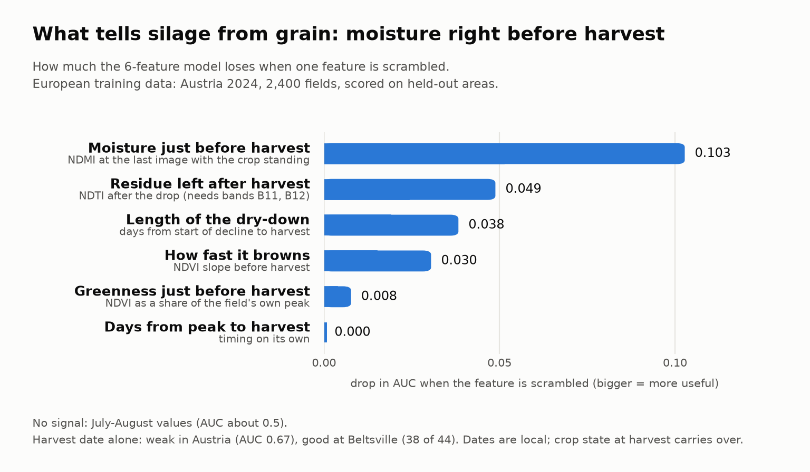
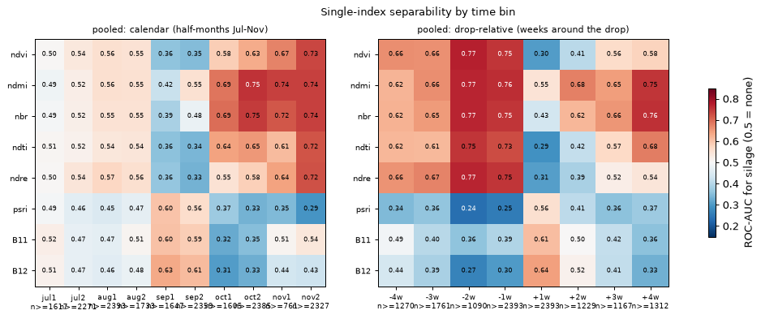
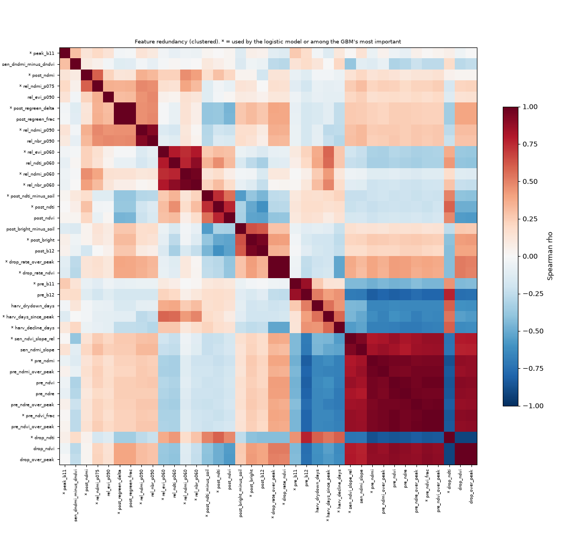

# Which features matter

Short answer: what separates silage from grain is the state of the crop when it is cut, not the
date. Silage is cut while the plant is still green and wet and almost nothing is left on the
ground. Grain is left to dry down first and leaves stalks behind.

All numbers on this page come from the European training data (Austria 2024, 2,400 fields, scored
on held-out areas). They are not from Beltsville.

## The six features the small model uses

"Importance" is how much the model's ROC-AUC drops when that one feature is shuffled between
fields (mean over five held-out folds, with the spread across folds).

| Feature | Name in the code | What it measures | Bands | Importance |
|---|---|---|---|---|
| Moisture just before harvest | `pre_ndmi` | NDMI at the last image with the crop still standing | B8A, B11 | 0.103 ± 0.020 |
| Residue left after harvest | `post_ndti` | NDTI at the first image after the drop | B11, B12 | 0.049 ± 0.019 |
| Length of the dry-down | `harv_decline_days` | Days from the start of the decline to the harvest | B04, B08 | 0.038 ± 0.030 |
| How fast it browns | `sen_ndvi_slope_rel` | NDVI slope before harvest, relative to the field's own range | B04, B08 | 0.030 ± 0.017 |
| Greenness just before harvest | `pre_ndvi_frac` | NDVI at the last standing image, as a share of the field's own peak | B04, B08 | 0.008 ± 0.007 |
| Days from peak to harvest | `harv_days_since_peak` | Timing on its own | B04, B08 | 0.000 ± 0.001 |

Moisture before harvest is clearly first. The next three are not distinguishable from each other
(their spreads overlap). The last two add almost nothing once the others are in the model.

## What did not help

- July and August values. A single index in a July or August half-month separates the classes at
  AUC 0.50 to 0.57, which is close to guessing. The two crops look the same until one of them is cut.
- The harvest date alone, in Europe. A rule on the date reaches AUC 0.67 in Austria. At Beltsville
  the same kind of rule gets 38 of 44 right, so dates are useful locally but do not carry from one
  region to another.
- "Divide by the field's own peak" versions of the same measurements. They correlate above 0.96 with
  the plain versions and gave no gain inside Austria.
- A pretrained satellite model (see `foundation-models.md`).
- More features. The 135-feature model is better inside Austria (AUC 0.86 against 0.78 for the six
  features) but worse on the Beltsville fields (30 of 44 against 42 of 44). Beltsville is 44
  field-years, so treat that gap as a warning, not a proof.

## When the signal appears

Each cell is one index at one time, used alone (0.5 = no use; red = higher for silage, blue =
lower). Left: by calendar half-month. Right: by weeks before and after the harvest drop. The right
panel is stronger: one to two weeks before the drop every greenness and moisture index reaches
0.75 to 0.77, and the week after the drop NDVI flips to 0.30 because a silage field is left barer.

## Features repeat each other

Spearman correlation between features, sorted so that similar ones sit together. The big red block
at the bottom right is about ten features that all say "how green and wet was the crop at harvest
and how large was the drop". Counting blocks, the 38 features shown carry about four or five
independent signals.

## Where things are

| What | Where |
|---|---|
| Feature code | `src/fieldvision/features/season.py`, `src/fieldvision/features/indices.py` |
| Models, evaluation, classify command | `src/fieldvision/model/` (`classify.py` writes one result per field and year) |
| The team-specified Beltsville rule (`timing_rule_v1`) | `src/fieldvision/beltsville/timing_rule.py` |
| Frozen model folders | `registry/` (see `registry/README.md`) |
| How the labels and the satellite time series are made | `labels.md`, `s2-extractor.md`, `data-handoff.md` |
| Model report and evaluation rules | `model.md` |

Field outlines and satellite time series are too large for git (Austria 2024 alone is about
160 MB). They are rebuilt with the commands in `labels.md` and `s2-extractor.md`.
