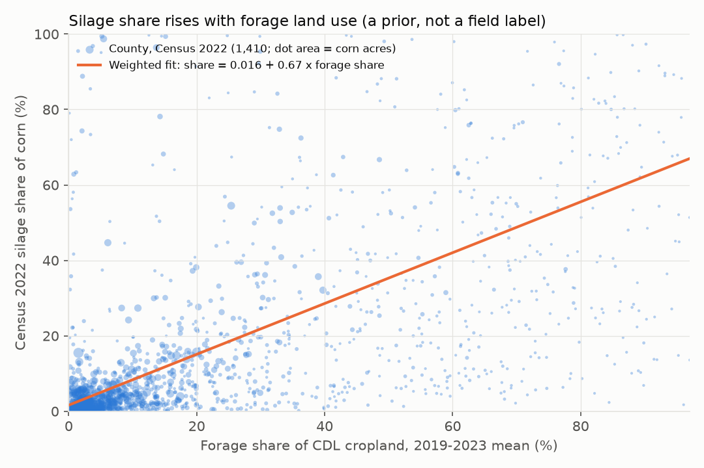

# Land-use prior for county and state silage shares

**What this is.** A prior from land use: how much of a county's corn is usually cut for silage,
predicted from how much of its cropland is in forage (alfalfa and hay). It is a proxy, not a field
label and not a satellite estimate. It describes a usual year in a place, cannot see a season that
departs from the usual, and says nothing about which field is silage. It is shown beside the
satellite figure; the modelling track decides whether and how the two are combined.

## Data and model

- Land use: CropScape county statistics of the Cropland Data Layer (30 m pixel acres by class), 2019-2025,
  2,890 counties (`scripts/fetch_cdl_county_stats.py`). Forage = alfalfa 36 + other hay 37 + clover 58 +
  vetch 224; cropland = CDL crop classes (1-61, 66-77, 204-254), which include forage and exclude grass/pasture.
- Target: Census 2022 county silage share = silage / (grain + silage) acres harvested, for the 1,410
  counties where both are published (selection rule in `fieldvision.model.quickstats`).
- Model: silage share = 0.016 + 0.674 x forage share (2019-2023 mean), linear, clipped to [0, 1],
  weighted by each county's grain + silage acres (`scripts/landuse_prior.py`). Weighted correlation 0.59.

## How well it holds (share points)

| Feature, form | 2022, whole state left out: county MAE | state error, acre-weighted | 2023 survey (199 counties, 7 states): county | state |
|---|---:|---:|---:|---:|
| forage share, own year, linear | 5.9 | 4.2 | 5.8 | 3.8 |
| **forage share, 2019-2023 mean, linear (used)** | **5.9** | **4.2** | **5.8** | **3.6** |
| forage + pasture share, linear | 7.5 | 6.0 | 7.8 | 5.9 |
| logit forms | 6.4-7.5 | 4.8-6.1 | 6.6-8.2 | 4.3-6.6 |
| national share for every county (baseline) | 9.0 | 7.7 | | |

County error is acre-weighted over counties; state error is |predicted - actual| of each state's pooled
share, acre-weighted over the 48 states. The unweighted mean over states is about 15 points because
small states with a few disclosed counties scatter widely. Forage + pasture is worse because grass/pasture
includes western rangeland.

**Why the 2019-2023 mean for 2025.** CDL 2024 and 2025 moved much "other hay" into grass/pasture (other hay
in the county table: 26 million acres in 2022-2023, 10 million in 2025; in Maryland's CSB about 100,000 to
38,000 while pasture rose from 60,000 to 145,000). The 2025 forage share is therefore not comparable with
the years the model was fitted on, and the break-robust forage + pasture share was worse on both checks.
This choice and the whole procedure were logged in `ACCESS_LOG.md` (19:48) before the 2025 prediction;
the state targets were already known to the team, which the log says.

## 2025: one comparison with the organisers' state targets

State share = county predictions weighted by CDL 2025 corn acres; silage acres = share x CDL 2025 corn
acres (CDL corn is closer to planted than harvested acres, so acres read high). Compared once; nothing was
refitted afterwards.

- 41 states: share error 3.7 points acre-weighted (median 5.8); the 15 states with at least a million corn
  acres: 2.6 (median 2.4).
- National: predicted 7.2 % silage against 6.4 %; 6.93 million silage acres against 6.01 million summed
  over the listed states.
- Pattern: the Corn Belt reads 1-3 points high; the western irrigated dairy states and New York read far low
  (California 9.9 % against 83 %, Arizona, Idaho, New Mexico, Washington, New York -20). Their silage comes from
  dairies on irrigated land with little hay in the cropland mix (orchards, cotton, vegetables), which this
  proxy cannot see.

| State | Grain + silage target | Target share % | Predicted % | Error | Target silage acres | Predicted silage acres |
|---|---:|---:|---:|---:|---:|---:|
| Iowa | 13,400,000 | 1.9 | 3.1 | +1.2 | 250,000 | 417,863 |
| Illinois | 11,040,000 | 0.8 | 2.2 | +1.4 | 90,000 | 249,819 |
| Nebraska | 10,610,000 | 2.1 | 5.3 | +3.2 | 220,000 | 559,569 |
| Minnesota | 8,800,000 | 4.1 | 5.8 | +1.8 | 360,000 | 511,063 |
| South Dakota | 6,740,000 | 5.8 | 9.7 | +3.9 | 390,000 | 650,716 |
| Kansas | 6,680,000 | 3.4 | 4.9 | +1.5 | 230,000 | 323,336 |
| Indiana | 5,350,000 | 2.1 | 3.5 | +1.4 | 110,000 | 190,629 |
| North Dakota | 4,660,000 | 3.6 | 6.1 | +2.4 | 170,000 | 275,599 |
| Wisconsin | 4,095,000 | 21.6 | 17.2 | -4.4 | 885,000 | 704,533 |
| Missouri | 3,740,000 | 2.7 | 10.4 | +7.7 | 100,000 | 383,595 |
| Ohio | 3,350,000 | 6.0 | 5.4 | -0.5 | 200,000 | 181,138 |
| Texas | 2,385,000 | 10.3 | 11.4 | +1.1 | 245,000 | 259,230 |
| Michigan | 2,320,000 | 14.7 | 11.4 | -3.3 | 340,000 | 284,257 |
| Kentucky | 1,485,000 | 4.4 | 14.8 | +10.5 | 65,000 | 211,124 |
| Colorado | 1,430,000 | 14.0 | 7.3 | -6.6 | 200,000 | 106,431 |
| Pennsylvania | 960,000 | 32.8 | 23.2 | -9.6 | 315,000 | 204,611 |
| North Carolina | 935,000 | 3.2 | 7.7 | +4.5 | 30,000 | 71,814 |
| New York | 930,000 | 53.2 | 32.8 | -20.5 | 495,000 | 323,989 |
| Tennessee | 900,000 | 3.9 | 13.2 | +9.3 | 35,000 | 112,688 |
| Mississippi | 875,000 | 1.1 | 4.6 | +3.4 | 10,000 | 38,923 |
| Louisiana | 793,000 | 0.4 | 5.4 | +5.0 | 3,000 | 43,492 |
| Arkansas | 793,000 | 0.4 | 3.0 | +2.6 | 3,000 | 22,699 |
| Georgia | 540,000 | 6.5 | 15.8 | +9.4 | 35,000 | 83,305 |
| Oklahoma | 510,000 | 4.9 | 6.9 | +2.0 | 25,000 | 35,272 |
| Virginia | 450,000 | 21.1 | 25.0 | +3.9 | 95,000 | 104,798 |
| Maryland | 450,000 | 8.9 | 10.6 | +1.7 | 40,000 | 46,230 |
| California | 445,000 | 83.1 | 9.9 | -73.3 | 370,000 | 20,587 |
| Idaho | 425,000 | 65.9 | 26.6 | -39.3 | 280,000 | 123,917 |
| South Carolina | 376,000 | 1.6 | 12.0 | +10.4 | 6,000 | 46,915 |
| Alabama | 334,000 | 1.2 | 21.2 | +20.0 | 4,000 | 69,913 |
| Washington | 224,000 | 44.2 | 13.3 | -30.9 | 99,000 | 31,891 |
| Delaware | 174,000 | 1.1 | 4.8 | +3.6 | 2,000 | 8,234 |
| Montana | 134,000 | 42.5 | 31.7 | -10.9 | 57,000 | 56,775 |
| Oregon | 109,000 | 31.2 | 20.7 | -10.5 | 34,000 | 26,165 |
| New Mexico | 103,000 | 57.3 | 11.9 | -45.4 | 59,000 | 9,075 |
| Utah | 82,000 | 59.8 | 48.1 | -11.7 | 49,000 | 47,186 |
| Florida | 81,000 | 29.6 | 23.9 | -5.7 | 24,000 | 15,805 |
| Wyoming | 77,000 | 29.9 | 42.0 | +12.1 | 23,000 | 39,007 |
| New Jersey | 73,000 | 8.2 | 15.4 | +7.2 | 6,000 | 11,181 |
| Arizona | 63,000 | 79.4 | 22.1 | -57.3 | 50,000 | 8,235 |
| West Virginia | 40,000 | 22.5 | 50.7 | +28.2 | 9,000 | 19,163 |

## Limits

- A land-use proxy: it carries the usual share of a place, not this season's decisions (drought, prices,
  feed shortages), and nothing about individual fields.
- Fitted on Census 2022 counties with both classes published; withheld counties (often small or
  dominated by one operation) are missing from the fit.
- Weak where silage is grown without much hay in the cropland (irrigated western dairies, New York), and
  in small states with few corn counties.
- The 2023 check covers only 7 states (counties that report both classes in the survey).

Files: `<data>\us\landuse\` (county_landuse.csv, census2022_with_landuse.csv, holdout_results.csv,
coefficients.json, state_prediction_2025.csv). Figure: `scripts/landuse_prior_figure.py`.
