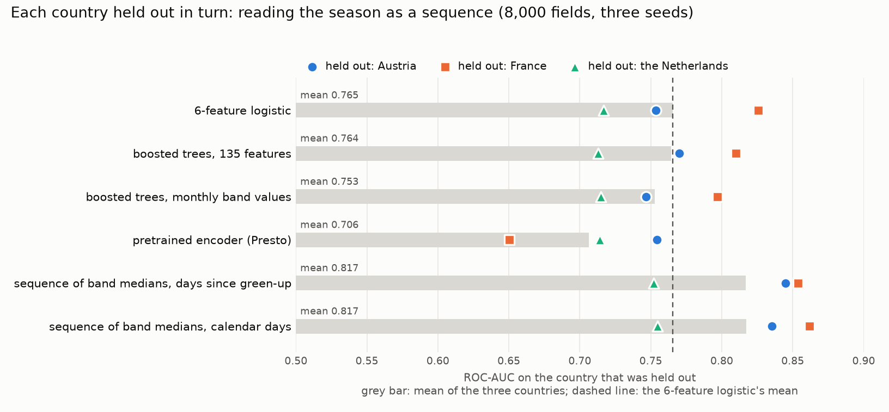

# The field as a stream in space and time

An experiment next to the main line, not a replacement for it. Code:
`src/fieldvision/stream/`, tests: `tests/test_stream_models.py`,
`tests/test_stream_pixels.py`. Outputs (not in git): `<data>\stream\`.

## In two sentences

**Time as a stream works.** A small network that reads each field's ten
band values date by date, with no new data, holds up across countries
better than anything else we have: with each country held out in turn
its mean ROC-AUC is 0.817, against 0.765 for the 6-feature logistic and
0.764 for the 135-feature boosted model, and it is ahead in all three
countries (clearly in Austria and France, at the edge in the
Netherlands).

**Space inside the field: not scored yet.** The pixel chips are being
extracted; this page gets the pixel models' rows when they are scored.

## The idea

Today every field is reduced, for each satellite pass, to one number per
band: the median over its pixels. A model then looks at features computed
from those numbers (harvest date, greenness before harvest, and so on).
Two things are lost on the way: the order and spacing of the passes
(the features summarise the season by hand), and everything that happens
inside the field (a half-harvested field looks like a half-green one).

The idea tested here is to stop summarising and give a model the season
as it was recorded: a short "video" of the field, time by height by
width by band, read by a network that looks across space and time
together.

| step | what the model sees at one date | what it adds | new data needed |
|---|---|---|---|
| main line | hand-made features of the season | (reference) | no |
| control: sequence | the ten band medians, date by date | time as a stream | no |
| pixel set | every pixel inside the field, in any order | spread inside the field | yes |
| chip + 2D convolution | a 120 m image chip | layout inside and around the field | yes |
| chip + 3D convolution | the chips stacked in time, like video frames | space and time in the same filters | yes |

The control is what tells the two halves of the idea apart: if it already
beats the features, the gain is "time as a stream"; whatever the three
pixel models add on top is "space".

## What was built

**Pixel chips** (`stream/pixels.py`). The existing extractor keeps only
medians and its code is frozen, so a separate module reads the same
scenes with the same catalog, grid, calibration and cloud-mask code
(imported, not copied) and saves, for every field and usable date, a
12 x 12 pixel chip (120 m) centred on the field: ten bands, the scene
classification, and a mask of the pixels inside the field. It also
writes the medians again, which gives an exact check: on the fields and
dates both tables hold, the medians must be the same numbers as in the
frozen table. They are: 19 of 19 and 12 of 12 field-dates on two test
extractions, and every full run repeats the check on all its field-dates
and stops below 99 % agreement.

Chips were extracted for a subset: whole read blocks drawn at random
inside every 10 km label block (seed 0) until each run had enough
fields. Reading time grows with blocks, not fields, and every label
block stays represented.

| run | fields with chips | of |
|---|---:|---:|
| Austria 2022 | 601 | 1,200 |
| Austria 2023 | 592 | 1,200 |
| Austria 2024 | 636 | 2,400 |
| France 2022 | 1,212 | 1,600 |
| the Netherlands 2025 | 1,241 | 1,600 |
| total | 4,282 | 8,000 |

**Models** (`stream/nets.py`), all small on purpose (81,000 to 435,000
weights for a few thousand training fields). All of them share one
temporal part: each date becomes a 64-number token, a time code is
added, two self-attention layers let every date look at every other
date, and the mean and maximum over the dates feed a two-layer head.
They differ only in how a date becomes a token:

- `seq`: a small network on the ten band medians (the control);
- `pixelset`: a shared network on every clear pixel inside the field,
  then the mean and the spread over the pixels (a pixel-set encoder;
  32 random pixels per date in training, all of them at test time);
- `chipseq`: three 2D convolution layers on the chip (bands, a clear-pixel
  mask and the inside-the-field mask as channels);
- `conv3d` has no attention: the chips are put on an even grid of 25
  ten-day steps (empty steps flagged) and read by 3D convolutions over
  time, height and width, the literal video form.

**Two clocks.** Every model exists with two ways of telling time:
calendar days (`-cal`), or days since the field's own green-up (`-rel`):
the day NDVI rises half-way from its low before the summer peak to that
peak. The second removes the planting calendar of the region and year,
which is what differs most between Austria, France, the Netherlands and
Maryland. It was declared the primary before any result; the calendar
version is shown beside it.

**Settings, fixed before any result and the same for every model and
fold** (`stream/train.py`): 30 epochs, batch 128, AdamW (learning rate
0.001 with cosine decay, weight decay 0.01), 20 % of a field's dates
hidden at random in each training step, band scaling from the training
fields only, three seeds averaged, the last epoch is the model (no early
stopping, nothing chosen on a held-out fold).

## How it was scored

Exactly as in `docs/foundation-models.md`, on the same fields and folds
(read back from that run's predictions): each country held out in turn
(Austria, France, the Netherlands), ROC-AUC on the held-out country, the
paired difference to the 6-feature logistic on the same fields with a
block-bootstrap 95 % interval (1,000 resamples of whole 10 km blocks),
and the loss against the same fields scored in-country (five spatial
folds). The evaluation set at Beltsville and all US county data were
not read.

## Results

Two separate claims, reported separately.

### Claim 1: time as a stream (the control, no new data)

All 8,000 labelled European fields (Austria 2022-2024, France 2022, the
Netherlands 2025), the existing per-field tables, run
`<data>\stream\colab_train_0\control_full`. Cell: ROC-AUC on the
held-out country, then the paired difference to the 6-feature logistic
[95 % interval]; "loss" = the same fields scored in-country minus out of
country. The reference rows are the ones of `docs/foundation-models.md`,
reproduced exactly.

| model | test Austria | loss | test France | loss | test the Netherlands | loss | mean |
|---|---|---:|---|---:|---|---:|---:|
| 6-feature logistic | 0.754 (ref) | 0.015 | 0.826 (ref) | 0.002 | 0.717 (ref) | -0.001 | 0.765 |
| boosted trees, 135 features | 0.770, +0.016 [+0.007, +0.025] | 0.078 | 0.810, -0.016 [-0.038, +0.009] | 0.036 | 0.713, -0.004 [-0.028, +0.020] | 0.027 | 0.764 |
| boosted trees, monthly band values | 0.747, -0.007 [-0.024, +0.014] | 0.093 | 0.797, -0.029 [-0.054, -0.001] | 0.050 | 0.715, -0.002 [-0.050, +0.047] | 0.022 | 0.753 |
| pretrained encoder (Presto) | 0.754, +0.001 [-0.019, +0.024] | 0.071 | 0.650, -0.175 [-0.197, -0.122] | 0.188 | 0.714, -0.003 [-0.044, +0.041] | 0.025 | 0.706 |
| **sequence, days since green-up** (`seq-rel`, primary) | 0.845, +0.092 [+0.082, +0.103] | 0.042 | 0.854, +0.028 [+0.007, +0.048] | 0.024 | 0.752, +0.035 [-0.003, +0.074] | 0.026 | **0.817** |
| sequence, calendar days (`seq-cal`) | 0.835, +0.082 [+0.069, +0.096] | 0.050 | 0.862, +0.036 [+0.015, +0.057] | 0.012 | 0.755, +0.038 [+0.000, +0.075] | 0.024 | 0.817 |



**Reading.**

- The sequence model is ahead of the logistic in all three countries:
  clearly in Austria (+0.09) and France (+0.03), and by +0.035 in the
  Netherlands, where the interval just touches zero. No other model we
  tried is clearly ahead of the logistic in more than one country (the
  best boosted combination is clearly ahead on Austria only).
- In-country it is also the best model we have (0.887, 0.877 and 0.778
  on the Austrian, French and Dutch fields; the boosted model 0.848,
  0.846, 0.740), and it loses 0.02-0.05 when the country is new: more
  than the logistic (0.00-0.02), less than the boosted models on Austria
  (0.08-0.09) and France (0.04-0.05), the same on the Netherlands. It
  keeps most of its lead when the country changes, which the boosted
  models did not.
- The same band values as monthly averages in a boosted model (0.753)
  and in a pretrained encoder (0.706) transferred worst. What differs
  here is the form: every date at its own time instead of a monthly
  average, a small network, and a random fifth of each field's dates
  hidden in every training step so it cannot lean on one date. (The
  augmentation test in `docs/foundation-models.md` found the same thing
  for the boosted model: hiding dates is what helps.)
- The two clocks give the same mean. Counting days from green-up helps
  on Austria, calendar days on France; the planting calendars of these
  three countries are too alike to tell them apart. Maryland would.
- Three seeds agree closely within a run (Austria 0.832-0.838, France
  0.837-0.847, the Netherlands 0.742-0.746 for `seq-rel`; the average of
  the three is the reported model). A separate one-seed run on another
  machine gave 0.800 on Austria, 0.844 on France and 0.748 on the
  Netherlands, so Austria, where the training set is smallest (3,200
  fields), moves by a few hundredths between runs; even that lowest run
  is ahead of the logistic in all three.
- Not fixed by this: in the Netherlands every model, this one included,
  calls about half of the grain fields silage at the plain 0.5 cut-off
  (false-positive rate 0.49). The ranking improves; the calibration
  problem stays.

### Claim 2: space inside the field (the pixel models)

Not scored yet. The chips for the 4,282 fields are being extracted; the
three pixel models and the control retrained on exactly those fields are
trained next, on the same folds, and their rows are added here.

## What it cost

- **The control** needs nothing new: it reads the tables the extractor
  already wrote. Training 16 model-folds with three seeds each took
  11 minutes on one T4 GPU (about 14 seconds a model), or 3-7 minutes a
  model on a busy laptop CPU. Scoring 1,000 fields takes 0.3 seconds on
  a laptop, and there are no features to compute first.
- **The chips** mean reading every scene again: about 200 read blocks,
  roughly two hours on an 8-core hosted runtime, and about 1.7 kB per
  chip (12 x 12 pixels, ten bands, compressed), so a few hundred
  megabytes for this subset instead of a few megabytes of medians.
- **What it does not give**: a reason. The logistic says "harvested 20
  days early at high moisture"; the sequence model gives a score. For
  the product the two fit together: the features explain, the sequence
  model ranks.

## Reproduce

```
python scripts/stream_subset.py --labels-root <data>\labels --out <data>\stream\subsets --seed 0 --plan at_2022:2022:400 at_2023:2023:400 at_2024:2024:400 fr_2022:2022:1000 nl_2025:2025:1000
python -m fieldvision.stream.pixels --fields <data>\stream\subsets\<run>\fields.geojson --year <year> --out <data>\stream\px\<run>
python -m fieldvision.stream.pixels check --run <data>\stream\px\<run> --reference <data>\timeseries\<run>\timeseries.parquet
python -m fieldvision.stream.folds --reference <data>\foundation\runs\at_fr_nl\predictions.parquet --out folds.parquet
python -m fieldvision.stream.train --folds folds.parquet --timeseries <data>\timeseries\<run>\timeseries.parquet ... --models seq --out <data>\stream\control_full
python -m fieldvision.stream.train --folds folds_subset.parquet --timeseries <data>\stream\px\<run>\timeseries.parquet ... --chips <data>\stream\px\<run>\chips.npz ... --models seq pixelset chipseq conv3d --out <data>\stream\subset
python -m fieldvision.stream.report --stream <data>\stream\subset --reference <data>\foundation\runs\at_fr_nl\predictions.parquet --out <data>\stream\report
```

`scripts/build_stream_bundle.py` and `scripts/build_stream_train_bundle.py`
pack the extraction and the training as notebook jobs for a hosted
runtime (the extraction with the frozen reading code).
